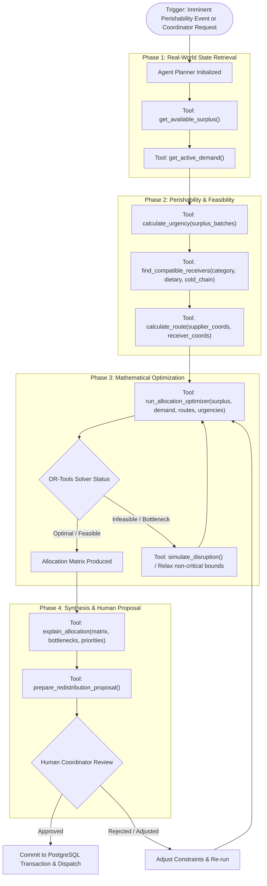

# FOOD HAS A DEADLINE (FHD) — AI AGENT ARCHITECTURE

> **Subsystem:** Agentic Redistribution Coordinator  
> **Core Model:** Google Gemini 2.5 Flash / 1.5 via `google-genai` SDK  
> **Integration Mode:** Function Calling (Typed Tools)  
> **Status:** Implemented & Verified (Module 9)  

---

## 1. System Role & Ethical Guardrails

The FHD AI Agent acts as an **Intelligent Operational Copilot** for food rescue dispatchers and coordinators. Its role is to synthesize complex, high-velocity operational variables (traffic delays, storage capacities, shelf-life decay curves, dietary incompatibilities) and orchestrate deterministic backend services.

### Core Architectural Principles:
1. **Never Calculate Math in the LLM:** The agent is strictly prohibited from computing distances, remaining hours, or split quantities inside its neural weights. All quantitative operations are delegated to deterministic tools (`calculate_urgency`, `calculate_route`, `run_allocation_optimizer`).
2. **Grounding in Actual Data:** The agent cannot reason about food redistribution without first querying live database state through `get_available_surplus` and `get_active_demand`. It is forbidden from inventing fictional donor or recipient facilities.
3. **No Autonomous Commits (Human-in-the-Loop):** The agent produces **Proposals** (`prepare_redistribution_proposal`). It cannot commit real-world dispatches or execute driver dispatches without authenticated human approval.
4. **Graceful Degradation:** If the Gemini API is unreachable, quota-exhausted, or unconfigured (`GEMINI_API_KEY` absent), the system operates seamlessly using deterministic rule-based coordination and heuristic explanations.

---

## 2. Agent Execution Workflow



---

## 3. Explicit Tool Contracts

Each tool is exposed to the Gemini model as a strictly typed schema. Validation is enforced using Pydantic v2 before and after tool execution.

### Tool 1: `get_available_surplus`
* **Purpose:** Queries active surplus food listings that have remaining unallocated quantity and have not passed their expiry deadline.
* **Input Contract:**
  ```json
  {
    "category": "string (optional: PRODUCE | DAIRY | BAKERY | PREPARED_MEALS | MEAT)",
    "max_remaining_hours": "number (optional: filter by maximum usable hours remaining)",
    "limit": "integer (default: 50)"
  }
  ```
* **Output Contract:**
  ```json
  {
    "total_found": "integer",
    "listings": [
      {
        "id": "string (UUID)",
        "supplier_id": "string (UUID)",
        "supplier_name": "string",
        "food_category": "string",
        "item_name": "string",
        "remaining_quantity_kg": "number",
        "storage_condition": "string",
        "food_condition": "string",
        "estimated_deadline": "string (ISO8601)",
        "latitude": "number",
        "longitude": "number"
      }
    ]
  }
  ```

---

### Tool 2: `get_active_demand`
* **Purpose:** Queries active recipient demands requiring fulfillment within the target operational horizon.
* **Input Contract:**
  ```json
  {
    "category": "string (optional)",
    "min_priority": "integer (optional: 1-5)",
    "limit": "integer (default: 50)"
  }
  ```
* **Output Contract:**
  ```json
  {
    "total_found": "integer",
    "demands": [
      {
        "id": "string (UUID)",
        "receiver_id": "string (UUID)",
        "organization_name": "string",
        "food_category": "string",
        "requested_quantity_kg": "number",
        "unfulfilled_quantity_kg": "number",
        "dietary_requirements": ["string"],
        "storage_capability": "string",
        "required_by": "string (ISO8601)",
        "priority_weight": "integer",
        "latitude": "number",
        "longitude": "number"
      }
    ]
  }
  ```

---

### Tool 3: `calculate_urgency`
* **Purpose:** Invokes the deterministic Perishability Intelligence Engine to classify urgency and compute remaining shelf-life.
* **Input Contract:**
  ```json
  {
    "food_category": "string",
    "harvest_or_prep_date": "string (ISO8601)",
    "storage_condition": "string (AMBIENT | REFRIGERATED | FROZEN)",
    "food_condition": "string (EXCELLENT | RIPE | IMMINENT_DECAY | IMPERFECT)",
    "estimated_deadline": "string (ISO8601)"
  }
  ```
* **Output Contract:**
  ```json
  {
    "urgency_classification": "string (CRITICAL | HIGH | MODERATE | LOW)",
    "remaining_hours": "number",
    "urgency_score": "number (0.0 to 1.0)",
    "decay_rate_per_hour": "number",
    "confidence": "string (HIGH | MEDIUM | ESTIMATED)",
    "warning_flags": ["string"]
  }
  ```

---

### Tool 4: `find_compatible_receivers`
* **Purpose:** Filters receiver facilities based on dietary compatibility, physical storage capability (refrigeration/freezer), and active operating intake hours.
* **Input Contract:**
  ```json
  {
    "food_category": "string",
    "storage_condition": "string",
    "is_halal": "boolean (optional)",
    "is_kosher": "boolean (optional)",
    "is_vegetarian": "boolean (optional)"
  }
  ```
* **Output Contract:**
  ```json
  {
    "compatible_receivers": [
      {
        "receiver_id": "string (UUID)",
        "organization_name": "string",
        "intake_capacity_remaining_kg": "number",
        "storage_compatible": "boolean",
        "dietary_compatible": "boolean"
      }
    ]
  }
  ```

---

### Tool 5: `calculate_route`
* **Purpose:** Queries OSRM road distance and transit duration between supplier and receiver coordinates, with automatic Haversine fallback.
* **Input Contract:**
  ```json
  {
    "origin_latitude": "number",
    "origin_longitude": "number",
    "destination_latitude": "number",
    "destination_longitude": "number"
  }
  ```
* **Output Contract:**
  ```json
  {
    "distance_km": "number",
    "transit_minutes": "integer",
    "engine_used": "string (OSRM_ROAD | HAVERSINE_FALLBACK)",
    "is_transit_feasible": "boolean (transit_minutes < remaining_shelf_life_minutes)"
  }
  ```

---

### Tool 6: `run_allocation_optimizer`
* **Purpose:** Invokes the Google OR-Tools MILP solver to compute the global multi-node optimal distribution matrix.
* **Input Contract:**
  ```json
  {
    "surplus_listing_ids": ["string (UUID)"],
    "demand_request_ids": ["string (UUID)"],
    "urgency_weight": "number (default: 1.5)",
    "distance_penalty_weight": "number (default: 0.8)",
    "priority_weight": "number (default: 1.2)"
  }
  ```
* **Output Contract:**
  ```json
  {
    "status": "string (OPTIMAL | FEASIBLE | INFEASIBLE)",
    "total_allocated_kg": "number",
    "total_unallocated_surplus_kg": "number",
    "total_unmet_demand_kg": "number",
    "allocations": [
      {
        "surplus_listing_id": "string (UUID)",
        "demand_request_id": "string (UUID)",
        "allocated_quantity_kg": "number",
        "transit_minutes": "integer",
        "distance_km": "number"
      }
    ],
    "unallocated_surplus": [
      {"surplus_listing_id": "string", "reason": "string"}
    ],
    "unmet_demand": [
      {"demand_request_id": "string", "reason": "string"}
    ]
  }
  ```

---

### Tool 7: `explain_allocation`
* **Purpose:** Analyzes the output of the OR-Tools optimization run and generates a concise, executive justification for human dispatchers.
* **Input Contract:**
  ```json
  {
    "allocation_summary": "object",
    "unallocated_items": ["object"],
    "bottlenecks": ["string"]
  }
  ```
* **Output Contract:**
  ```json
  {
    "executive_summary": "string",
    "key_tradeoffs": ["string"],
    "recommended_actions": ["string"],
    "perishability_risk_alert": "string (optional)"
  }
  ```

---

### Tool 8: `simulate_disruption`
* **Purpose:** Evaluates the impact of unexpected disruptions (e.g., recipient vehicle breakdown or traffic gridlock) using in-memory state.
* **Input Contract:**
  ```json
  {
    "disruption_type": "string (RECEIVER_DROPOUT | ROUTE_BLOCKED | DEADLINE_ACCELERATED)",
    "target_entity_id": "string (UUID)",
    "severity_factor": "number"
  }
  ```
* **Output Contract:**
  ```json
  {
    "scenario_name": "string",
    "baseline_salvaged_kg": "number",
    "simulated_salvaged_kg": "number",
    "salvage_loss_kg": "number",
    "re_allocation_recommendation": ["string"]
  }
  ```

---

### Tool 9: `prepare_redistribution_proposal`
* **Purpose:** Persists an allocation proposal to PostgreSQL with status `PENDING_REVIEW` for dispatcher confirmation.
* **Input Contract:**
  ```json
  {
    "allocations": ["object"],
    "total_allocated_kg": "number",
    "total_unallocated_kg": "number",
    "total_unmet_demand_kg": "number",
    "ai_justification": "string",
    "solver_status": "string"
  }
  ```
* **Output Contract:**
  ```json
  {
    "proposal_id": "string (UUID)",
    "status": "PENDING_REVIEW",
    "created_at": "string (ISO8601)",
    "message": "Proposal successfully queued for human dispatcher authorization."
  }
  ```

---

## 4. Resilience, Abstraction & Deterministic Fallback

### 4.1 AI Provider Abstraction Interface
The backend defines a clean Python abstraction interface:
```python
class BaseAIAssistant(ABC):
    @abstractmethod
    async def orchestrate_redistribution(
        self, context: RedistributionContext
    ) -> AllocationProposalResponse:
        pass

    @abstractmethod
    async def explain_results(
        self, optimization_result: OptimizationResult
    ) -> str:
        pass
```

### 4.2 Deterministic Fallback Engine
When `GEMINI_API_KEY` is not supplied or the Gemini API returns HTTP 429/503:
1. The system automatically switches to `ResponseBuilder.build_deterministic_fallback`.
2. The fallback intent parser recognizes queries for surplus listings, receiver demands, perishability decay, routing, and optimization runs.
3. Relevant deterministic backend tools (`ToolExecutor.execute`) are directly invoked under the authenticated user's security context.
4. Natural language justifications, summaries, and Markdown tables are compiled deterministically.
5. All system features remain 100% operational without degrading into a broken state.

---

## 5. Implemented Architecture Package (`backend/app/agent/`)

```
backend/app/agent/
├── __init__.py               # Clean package exports
├── models.py                 # Pydantic schemas (ChatRequest, ChatResponse, ProposalPreview, ToolCallRecord)
├── safety_guard.py           # System instructions, prompt injection defenses, API key redactions
├── tool_registry.py          # Central registry of 10 tools, parameter schemas, and RBAC authorization
├── tool_executor.py          # Safe execution wrappers calling deterministic backend services
├── gemini_provider.py        # google-genai SDK wrapper, HTTP 429/503 error normalization, retries
├── response_builder.py       # Response synthesis, proposal extraction, deterministic fallback dispatch
├── conversation_service.py   # PostgreSQL conversation CRUD, history bounding, multi-tenant isolation
└── agent_service.py          # Orchestration pipeline coordinating Gemini, tools, safety, and fallback
```

### 5.1 Verification Status
- **Test Suite:** `backend/tests/test_agent.py` (27 passed tests)
- **Total Project Suite:** 142 passed tests across all modules (0 failures)
- **Frontend Copilot:** `/assistant` page implemented in React + TypeScript + Tailwind CSS with live tool execution cards and proposal review badges.

