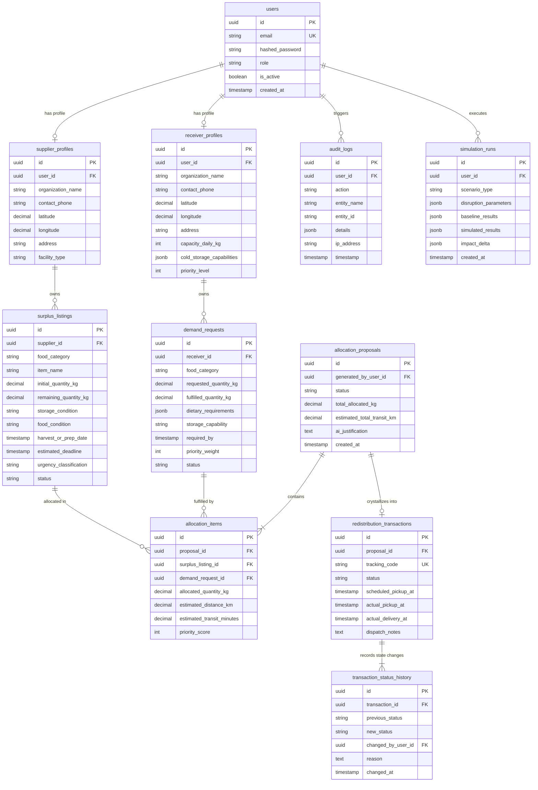

# FOOD HAS A DEADLINE (FHD) — DATABASE DESIGN SPECIFICATION

> **Database Engine:** PostgreSQL 16+  
> **ORM Framework:** SQLAlchemy 2.0 (psycopg 3 binary driver)  
> **Migration Manager:** Alembic  
> **Status:** Relational Schema Specification (No physical tables created in this module)

---

## 1. Entity-Relationship Overview



---

## 2. Relational Schema Definitions

### 2.1 User Management Subsystem

#### Table: `users`
Represents platform identity, credentials, and access roles.

| Column | Type | Nullable | Constraints & Defaults | Description |
| :--- | :--- | :---: | :--- | :--- |
| `id` | `UUID` | No | `PRIMARY KEY, DEFAULT gen_random_uuid()` | Unique user identifier |
| `email` | `VARCHAR(255)` | No | `UNIQUE, NOT NULL` | Login email address |
| `hashed_password` | `VARCHAR(255)` | No | `NOT NULL` | Argon2 password hash |
| `role` | `VARCHAR(32)` | No | `CHECK (role IN ('SUPPLIER', 'RECEIVER', 'ADMIN', 'COORDINATOR'))` | System RBAC authorization role |
| `is_active` | `BOOLEAN` | No | `DEFAULT TRUE` | Account active flag |
| `is_verified` | `BOOLEAN` | No | `DEFAULT FALSE` | Email/identity verification flag |
| `created_at` | `TIMESTAMPTZ` | No | `DEFAULT NOW()` | Account creation timestamp |
| `updated_at` | `TIMESTAMPTZ` | No | `DEFAULT NOW()` | Last profile update timestamp |

* **Indexes:** `idx_users_email` (BTREE, Unique), `idx_users_role` (BTREE).

---

#### Table: `supplier_profiles`
Profile details for food donors (grocers, restaurants, distributors, farms).

| Column | Type | Nullable | Constraints & Defaults | Description |
| :--- | :--- | :---: | :--- | :--- |
| `id` | `UUID` | No | `PRIMARY KEY, DEFAULT gen_random_uuid()` | Profile identifier |
| `user_id` | `UUID` | No | `UNIQUE, FOREIGN KEY (user_id) REFERENCES users(id) ON DELETE CASCADE` | 1-to-1 link to user |
| `organization_name` | `VARCHAR(255)` | No | `NOT NULL` | Business / entity legal name |
| `contact_phone` | `VARCHAR(32)` | No | `NOT NULL` | Dispatch phone number |
| `latitude` | `NUMERIC(9,6)` | No | `CHECK (latitude BETWEEN -90 AND 90)` | WGS84 GPS latitude |
| `longitude` | `NUMERIC(9,6)` | No | `CHECK (longitude BETWEEN -180 AND 180)` | WGS84 GPS longitude |
| `address` | `TEXT` | No | `NOT NULL` | Physical pickup address |
| `facility_type` | `VARCHAR(64)` | No | `NOT NULL` | e.g., 'SUPERMARKET', 'FARM', 'RESTAURANT', 'FOOD_PROCESSOR' |
| `operating_hours` | `JSONB` | Yes | `DEFAULT '{}'::jsonb` | Pickup operating schedule per day |
| `created_at` | `TIMESTAMPTZ` | No | `DEFAULT NOW()` | Creation timestamp |

* **Indexes:** `idx_supplier_coords` (BTREE on `(latitude, longitude)`), `idx_supplier_user` (BTREE on `user_id`).

---

#### Table: `receiver_profiles`
Profile details for food recipients (soup kitchens, shelters, food pantries).

| Column | Type | Nullable | Constraints & Defaults | Description |
| :--- | :--- | :---: | :--- | :--- |
| `id` | `UUID` | No | `PRIMARY KEY, DEFAULT gen_random_uuid()` | Profile identifier |
| `user_id` | `UUID` | No | `UNIQUE, FOREIGN KEY (user_id) REFERENCES users(id) ON DELETE CASCADE` | 1-to-1 link to user |
| `organization_name` | `VARCHAR(255)` | No | `NOT NULL` | Organization legal name |
| `contact_phone` | `VARCHAR(32)` | No | `NOT NULL` | Coordinator contact phone |
| `latitude` | `NUMERIC(9,6)` | No | `CHECK (latitude BETWEEN -90 AND 90)` | WGS84 GPS latitude |
| `longitude` | `NUMERIC(9,6)` | No | `CHECK (longitude BETWEEN -180 AND 180)` | WGS84 GPS longitude |
| `address` | `TEXT` | No | `NOT NULL` | Delivery destination address |
| `capacity_daily_kg` | `NUMERIC(10,2)`| No | `CHECK (capacity_daily_kg > 0)` | Maximum storage/intake capacity per day |
| `cold_storage_capabilities`| `JSONB` | No | `DEFAULT '{"refrigeration": false, "freezer": false}'::jsonb` | Cold chain hardware capabilities |
| `priority_level` | `INTEGER` | No | `CHECK (priority_level BETWEEN 1 AND 5), DEFAULT 3` | Social priority weighting (5 = highest urgency/need) |
| `created_at` | `TIMESTAMPTZ` | No | `DEFAULT NOW()` | Creation timestamp |

* **Indexes:** `idx_receiver_coords` (BTREE on `(latitude, longitude)`), `idx_receiver_priority` (BTREE on `priority_level`).

---

### 2.2 Supply and Demand Subsystem

#### Table: `surplus_listings`
Tracks available perishable food batches offered by suppliers.

| Column | Type | Nullable | Constraints & Defaults | Description |
| :--- | :--- | :---: | :--- | :--- |
| `id` | `UUID` | No | `PRIMARY KEY, DEFAULT gen_random_uuid()` | Surplus batch ID |
| `supplier_id` | `UUID` | No | `FOREIGN KEY (supplier_id) REFERENCES supplier_profiles(id) ON DELETE RESTRICT` | Owning supplier |
| `food_category` | `VARCHAR(64)` | No | `NOT NULL` | e.g. 'PRODUCE', 'DAIRY', 'BAKERY', 'PREPARED_MEALS', 'MEAT' |
| `item_name` | `VARCHAR(255)` | No | `NOT NULL` | Description of food batch |
| `initial_quantity_kg` | `NUMERIC(10,2)`| No | `CHECK (initial_quantity_kg > 0)` | Original posted weight |
| `remaining_quantity_kg` | `NUMERIC(10,2)`| No | `CHECK (remaining_quantity_kg >= 0 AND remaining_quantity_kg <= initial_quantity_kg)` | Unallocated available weight |
| `storage_condition` | `VARCHAR(32)` | No | `CHECK (storage_condition IN ('AMBIENT', 'REFRIGERATED', 'FROZEN'))` | Current required cold chain |
| `food_condition` | `VARCHAR(32)` | No | `CHECK (food_condition IN ('EXCELLENT', 'RIPE', 'IMMINENT_DECAY', 'IMPERFECT'))` | Visual / physical condition |
| `harvest_or_prep_date`| `TIMESTAMPTZ` | No | `NOT NULL` | Timestamp of preparation / harvest |
| `estimated_deadline` | `TIMESTAMPTZ` | No | `NOT NULL` | Strict deadline before spoilage |
| `urgency_classification`| `VARCHAR(16)`| No | `CHECK (urgency_classification IN ('CRITICAL', 'HIGH', 'MODERATE', 'LOW'))` | Output of deterministic decay engine |
| `status` | `VARCHAR(32)` | No | `CHECK (status IN ('AVAILABLE', 'ALLOCATING', 'EXHAUSTED', 'EXPIRED', 'CANCELLED')), DEFAULT 'AVAILABLE'` | Inventory status |
| `created_at` | `TIMESTAMPTZ` | No | `DEFAULT NOW()` | Listing creation time |
| `updated_at` | `TIMESTAMPTZ` | No | `DEFAULT NOW()` | Last update timestamp |

* **Constraints:**
  * `CHECK (estimated_deadline > harvest_or_prep_date)`
* **Indexes:**
  * `idx_surplus_deadline_status` (BTREE on `(status, estimated_deadline)`),
  * `idx_surplus_supplier` (BTREE on `supplier_id`),
  * `idx_surplus_category` (BTREE on `food_category`).

---

#### Table: `demand_requests`
Tracks food requests and intake quotas from receiver organizations.

| Column | Type | Nullable | Constraints & Defaults | Description |
| :--- | :--- | :---: | :--- | :--- |
| `id` | `UUID` | No | `PRIMARY KEY, DEFAULT gen_random_uuid()` | Demand request ID |
| `receiver_id` | `UUID` | No | `FOREIGN KEY (receiver_id) REFERENCES receiver_profiles(id) ON DELETE RESTRICT` | Owning receiver profile |
| `food_category` | `VARCHAR(64)` | No | `NOT NULL` | Required category or 'ANY' |
| `requested_quantity_kg`| `NUMERIC(10,2)`| No | `CHECK (requested_quantity_kg > 0)` | Total demand volume |
| `fulfilled_quantity_kg`| `NUMERIC(10,2)`| No | `CHECK (fulfilled_quantity_kg >= 0 AND fulfilled_quantity_kg <= requested_quantity_kg), DEFAULT 0` | Allocated/delivered volume |
| `dietary_requirements` | `JSONB` | No | `DEFAULT '[]'::jsonb` | e.g. `["HALAL", "VEGETARIAN"]` |
| `storage_capability` | `VARCHAR(32)` | No | `CHECK (storage_capability IN ('AMBIENT', 'REFRIGERATED', 'FROZEN'))` | Minimum storage available |
| `required_by` | `TIMESTAMPTZ` | No | `NOT NULL` | Cut-off time for meal prep/service |
| `priority_weight` | `INTEGER` | No | `CHECK (priority_weight BETWEEN 1 AND 5), DEFAULT 3` | Priority weighting for this request |
| `status` | `VARCHAR(32)` | No | `CHECK (status IN ('ACTIVE', 'PARTIALLY_FULFILLED', 'FULFILLED', 'EXPIRED', 'CANCELLED')), DEFAULT 'ACTIVE'` | Request lifecycle status |
| `created_at` | `TIMESTAMPTZ` | No | `DEFAULT NOW()` | Creation timestamp |

* **Indexes:**
  * `idx_demand_status_reqby` (BTREE on `(status, required_by)`),
  * `idx_demand_receiver` (BTREE on `receiver_id`).

---

### 2.3 Redistribution and Matching Subsystem

#### Table: `allocation_proposals`
Represents an optimization run outcome packaged for human coordinator review.

| Column | Type | Nullable | Constraints & Defaults | Description |
| :--- | :--- | :---: | :--- | :--- |
| `id` | `UUID` | No | `PRIMARY KEY, DEFAULT gen_random_uuid()` | Proposal unique ID |
| `generated_by_user_id`| `UUID` | Yes | `FOREIGN KEY (generated_by_user_id) REFERENCES users(id)` | User or automated scheduler |
| `status` | `VARCHAR(32)` | No | `CHECK (status IN ('PENDING_REVIEW', 'APPROVED', 'ACCEPTED', 'EXECUTING', 'COMPLETED', 'REJECTED', 'CANCELLED', 'FAILED', 'SUPERSEDED')), DEFAULT 'PENDING_REVIEW'` | Review status |
| `total_allocated_kg` | `NUMERIC(10,2)`| No | `CHECK (total_allocated_kg > 0)` | Cumulative weight allocated |
| `total_unallocated_kg` | `NUMERIC(10,2)`| No | `CHECK (total_unallocated_kg >= 0)` | Unsalvaged surplus remaining |
| `total_unmet_demand_kg`| `NUMERIC(10,2)`| No | `CHECK (total_unmet_demand_kg >= 0)` | Unfulfilled demand remaining |
| `estimated_total_transit_km` | `NUMERIC(8,2)` | Yes | `CHECK (estimated_total_transit_km >= 0)` | Total network travel distance |
| `ai_justification` | `TEXT` | Yes | NULL | Plain English justification generated by AI Agent |
| `solver_status` | `VARCHAR(32)` | No | `NOT NULL` | e.g. 'OPTIMAL', 'FEASIBLE', 'INFEASIBLE' |
| `rejection_reason` | `TEXT` | Yes | NULL | Mandatory operational rationale recorded upon rejection |
| `created_at` | `TIMESTAMPTZ` | No | `DEFAULT NOW()` | Proposal timestamp |

* **Indexes:** `idx_proposals_status` (BTREE on `status`).

---

#### Table: `allocation_items`
Detailed line-item matches connecting a specific surplus listing to a demand request.

| Column | Type | Nullable | Constraints & Defaults | Description |
| :--- | :--- | :---: | :--- | :--- |
| `id` | `UUID` | No | `PRIMARY KEY, DEFAULT gen_random_uuid()` | Match item ID |
| `proposal_id` | `UUID` | No | `FOREIGN KEY (proposal_id) REFERENCES allocation_proposals(id) ON DELETE CASCADE` | Parent proposal |
| `surplus_listing_id` | `UUID` | No | `FOREIGN KEY (surplus_listing_id) REFERENCES surplus_listings(id) ON DELETE RESTRICT` | Source supply batch |
| `demand_request_id` | `UUID` | No | `FOREIGN KEY (demand_request_id) REFERENCES demand_requests(id) ON DELETE RESTRICT` | Target demand |
| `allocated_quantity_kg`| `NUMERIC(10,2)`| No | `CHECK (allocated_quantity_kg > 0)` | Weight allocated for this pair |
| `estimated_distance_km`| `NUMERIC(8,2)` | No | `CHECK (estimated_distance_km >= 0)` | Estimated transit distance |
| `estimated_transit_minutes`| `INTEGER` | No | `CHECK (estimated_transit_minutes >= 0)` | Estimated road transit duration |
| `urgency_at_allocation`| `VARCHAR(16)` | No | `NOT NULL` | Urgency tier at match time |
| `created_at` | `TIMESTAMPTZ` | No | `DEFAULT NOW()` | Creation timestamp |

---

#### Table: `redistribution_transactions`
The committed, legally binding logistics execution record created when an allocation proposal is authorized by a coordinator.

| Column | Type | Nullable | Constraints & Defaults | Description |
| :--- | :--- | :---: | :--- | :--- |
| `id` | `UUID` | No | `PRIMARY KEY, DEFAULT gen_random_uuid()` | Transaction ID |
| `proposal_id` | `UUID` | No | `FOREIGN KEY (proposal_id) REFERENCES allocation_proposals(id) ON DELETE RESTRICT` | Associated authorized proposal |
| `tracking_code` | `VARCHAR(32)` | No | `UNIQUE, NOT NULL` | Public custody tracking reference (`FHD-TX-YYYYMMDD-HEX`) |
| `status` | `VARCHAR(32)` | No | `CHECK (status IN ('APPROVED', 'SCHEDULED', 'PICKUP_SCHEDULED', 'DISPATCHED', 'PICKED_UP', 'IN_TRANSIT', 'DELIVERED', 'COMPLETED', 'FAILED', 'CANCELLED')), DEFAULT 'APPROVED'` | Checkpoint status |
| `scheduled_pickup_at` | `TIMESTAMPTZ` | Yes | NULL | Agreed pickup appointment |
| `actual_pickup_at` | `TIMESTAMPTZ` | Yes | NULL | Driver recorded pickup timestamp |
| `actual_delivery_at` | `TIMESTAMPTZ` | Yes | NULL | Receiver verified delivery timestamp |
| `dispatch_notes` | `TEXT` | Yes | NULL | Gate codes, dock instructions, special handling |
| `created_at` | `TIMESTAMPTZ` | No | `DEFAULT NOW()` | Record creation timestamp |
| `updated_at` | `TIMESTAMPTZ` | No | `DEFAULT NOW()` | Checkpoint modification timestamp |

* **Indexes:**
  * `idx_alloc_items_proposal` (BTREE on `proposal_id`),
  * `idx_alloc_items_surplus` (BTREE on `surplus_listing_id`),
  * `idx_alloc_items_demand` (BTREE on `demand_request_id`).

---

#### Table: `redistribution_transactions`
The legally and operationally binding dispatch transaction committed upon proposal acceptance.

| Column | Type | Nullable | Constraints & Defaults | Description |
| :--- | :--- | :---: | :--- | :--- |
| `id` | `UUID` | No | `PRIMARY KEY, DEFAULT gen_random_uuid()` | Transaction ID |
| `proposal_id` | `UUID` | No | `FOREIGN KEY (proposal_id) REFERENCES allocation_proposals(id) ON DELETE RESTRICT` | Accepted proposal source |
| `tracking_code` | `VARCHAR(32)` | No | `UNIQUE, NOT NULL` | Human-readable tracking identifier (e.g. `FHD-2026-X89J`) |
| `status` | `VARCHAR(32)` | No | `CHECK (status IN ('SCHEDULED', 'DISPATCHED', 'IN_TRANSIT', 'DELIVERED', 'FAILED', 'CANCELLED')), DEFAULT 'SCHEDULED'` | Dispatch state |
| `scheduled_pickup_at` | `TIMESTAMPTZ` | Yes | NULL | Agreed pickup appointment |
| `actual_pickup_at` | `TIMESTAMPTZ` | Yes | NULL | Recorded driver departure from supplier |
| `actual_delivery_at` | `TIMESTAMPTZ` | Yes | NULL | Recorded driver arrival at receiver |
| `dispatch_notes` | `TEXT` | Yes | NULL | Special instructions (loading dock, contact, etc.) |
| `created_at` | `TIMESTAMPTZ` | No | `DEFAULT NOW()` | Transaction creation timestamp |
| `updated_at` | `TIMESTAMPTZ` | No | `DEFAULT NOW()` | Last update timestamp |

* **Indexes:**
  * `idx_tx_tracking` (BTREE, Unique on `tracking_code`),
  * `idx_tx_status` (BTREE on `status`).

---

#### Table: `transaction_status_history`
Append-only audit trail capturing every state progression of a redistribution transaction.

| Column | Type | Nullable | Constraints & Defaults | Description |
| :--- | :--- | :---: | :--- | :--- |
| `id` | `UUID` | No | `PRIMARY KEY, DEFAULT gen_random_uuid()` | Log entry ID |
| `transaction_id` | `UUID` | No | `FOREIGN KEY (transaction_id) REFERENCES redistribution_transactions(id) ON DELETE CASCADE` | Target transaction |
| `previous_status` | `VARCHAR(32)` | Yes | NULL | Prior status (`NULL` on initial creation) |
| `new_status` | `VARCHAR(32)` | No | `NOT NULL` | New status entered |
| `changed_by_user_id` | `UUID` | No | `FOREIGN KEY (changed_by_user_id) REFERENCES users(id)` | User or driver executing transition |
| `reason` | `TEXT` | Yes | NULL | Operational reason or delay explanation |
| `changed_at` | `TIMESTAMPTZ` | No | `DEFAULT NOW()` | Exact timestamp of change |

* **Indexes:** `idx_tx_history_txid` (BTREE on `transaction_id`).

---

### 2.4 System Intelligence and Auditing

#### Table: `simulation_runs`
Captures hypothetical disruption evaluations run by operators without modifying actual data.

| Column | Type | Nullable | Constraints & Defaults | Description |
| :--- | :--- | :---: | :--- | :--- |
| `id` | `UUID` | No | `PRIMARY KEY, DEFAULT gen_random_uuid()` | Simulation ID |
| `user_id` | `UUID` | No | `FOREIGN KEY (user_id) REFERENCES users(id)` | Coordinator executing scenario |
| `scenario_type` | `VARCHAR(64)` | No | `NOT NULL` | e.g., 'RECEIVER_UNAVAILABLE', 'TRANSIT_DELAY', 'SHELF_LIFE_REDUCED' |
| `disruption_parameters`| `JSONB` | No | `NOT NULL` | Parameters injected (e.g., `{"blocked_receiver_id": "...", "delay_hours": 2}`) |
| `baseline_results` | `JSONB` | No | `NOT NULL` | Baseline metrics prior to shock |
| `simulated_results` | `JSONB` | No | `NOT NULL` | Results under disruption conditions |
| `impact_delta` | `JSONB` | No | `NOT NULL` | Computed delta (lost food kg, unmet demand delta) |
| `created_at` | `TIMESTAMPTZ` | No | `DEFAULT NOW()` | Execution timestamp |

---

#### Table: `audit_logs`
System-wide security and operations audit trail.

| Column | Type | Nullable | Constraints & Defaults | Description |
| :--- | :--- | :---: | :--- | :--- |
| `id` | `UUID` | No | `PRIMARY KEY, DEFAULT gen_random_uuid()` | Audit log entry ID |
| `user_id` | `UUID` | Yes | `FOREIGN KEY (user_id) REFERENCES users(id) ON DELETE SET NULL` | Performing user |
| `action` | `VARCHAR(64)` | No | `NOT NULL` | e.g., 'CREATE_LISTING', 'ACCEPT_PROPOSAL', 'UPDATE_STATUS' |
| `entity_name` | `VARCHAR(64)` | No | `NOT NULL` | Database table affected |
| `entity_id` | `VARCHAR(64)` | No | `NOT NULL` | String representation of affected PK |
| `details` | `JSONB` | Yes | `DEFAULT '{}'::jsonb` | State changes, metadata, reason |
| `ip_address` | `VARCHAR(45)` | Yes | NULL | Client IP address |
| `timestamp` | `TIMESTAMPTZ` | No | `DEFAULT NOW()` | Event timestamp |

* **Indexes:** `idx_audit_entity` (BTREE on `(entity_name, entity_id)`), `idx_audit_timestamp` (BTREE on `timestamp`).

---

## 3. Strict Concurrency and Business Rule Enforcement

### 3.1 Protection Against Overselling (Anti-Race Condition)
When multiple allocation proposals or manual coordinator dispatches attempt to allocate from the same `surplus_listings`, standard database updates risk overselling inventory. FHD mitigates this using:
1. **Row-Level Exclusive Locks:**
   ```sql
   SELECT id, remaining_quantity_kg, status 
   FROM surplus_listings 
   WHERE id = :listing_id 
   FOR UPDATE;
   ```
2. **Atomic Verification:**
   ```sql
   UPDATE surplus_listings
   SET remaining_quantity_kg = remaining_quantity_kg - :allocated_qty,
       status = CASE WHEN remaining_quantity_kg - :allocated_qty = 0 THEN 'EXHAUSTED' ELSE 'ALLOCATING' END,
       updated_at = NOW()
   WHERE id = :listing_id AND remaining_quantity_kg >= :allocated_qty;
   ```
   If zero rows are updated, the transaction raises an `InventoryConflictError` and rolls back.

### 3.2 Guarantee of Expired Inventory Exclusion
Active queries filtering candidate surplus enforce a database-level deadline filter:
```sql
WHERE status = 'AVAILABLE' AND estimated_deadline > NOW() + INTERVAL '30 minutes'
```
Any item with less than 30 minutes remaining is classified as un-dispatchable and automatically updated to `EXPIRED` to prevent driver dispatch to spoilable inventory.
