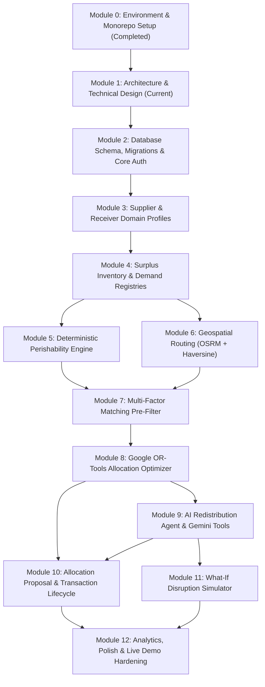

# FOOD HAS A DEADLINE (FHD) — IMPLEMENTATION ROADMAP & HACKATHON ALIGNMENT

> **Target:** 48-Hour Hackathon Implementation Strategy  
> **Approach:** Dependency-Aware, Test-Driven & Demo-Prioritized  
> **Status:** Implementation Plan  

---

## 1. Hackathon Evaluation Alignment Matrix

| Evaluation Criterion | Weight | Architectural & Technical Evidence Required for Top Score |
| :--- | :---: | :--- |
| **Technical Architecture** | **20%** | • Clear separation: API $\to$ Service $\to$ Repository $\to$ Database. • Relational integrity: Foreign keys, strict constraints, row-level locking against overselling. • Google OR-Tools optimization formulation with mathematical rigor. • Strongly-typed API contracts with Pydantic and Zod. |
| **AI Reasoning** | **25%** | • Agent interacts purely via explicit, typed tools. • Actual data retrieval before reasoning (zero hallucination). • Explains complex tradeoffs and optimization decisions to human coordinators. • Non-destructive What-If disruption simulations. |
| **Problem Relevance** | **25%** | • Solves the core bottleneck in food rescue: **perishability deadline**. • Deterministic decay modeling based on USDA/FDA reference standards. • Dynamic multi-receiver allocation: 1-to-many, many-to-1, partial allocations. • Dietary and cold-chain hardware compatibility enforcement. |
| **Demo & Robustness** | **30%** | • Complete end-to-end operational flow from surplus posting to dispatch tracking. • Interactive Leaflet map with real geospatial routing. • Resilient fallback if Gemini API or OSRM is unavailable. • Passing automated test suite and live health-check endpoint. |

---

## 2. Dependency Graph

---

## 3. Detailed Phase Breakdown & Testable Acceptance Criteria

### Phase 2: Database Schema, Migrations & Core Auth
* **Dependencies:** Module 0, Module 1.
* **Scope:**
  * Implement SQLAlchemy 2.0 models for `users`, `supplier_profiles`, `receiver_profiles`.
  * Alembic migration script generation.
  * Password hashing (`pwdlib[argon2]`), JWT creation, and login/register endpoints.
* **Acceptance Criteria:**
  * `POST /api/v1/auth/register` creates a user and hashes password with Argon2.
  * `POST /api/v1/auth/login` returns valid JWT access token.
  * Attempting duplicate email returns `400 Bad Request`.
  * Status: **ESSENTIAL FOR DEMO**.

---

### Phase 3: Supplier & Receiver Domain Profiles
* **Dependencies:** Phase 2.
* **Scope:**
  * Profile creation and retrieval endpoints with GPS coordinate validation.
  * Cold-storage capability tagging and capacity boundaries.
* **Acceptance Criteria:**
  * Supplier can save facility address and valid coordinates.
  * Receiver can register intake capacity (kg/day) and refrigeration status.
  * Status: **ESSENTIAL FOR DEMO**.

---

### Phase 4: Surplus Inventory & Demand Registries
* **Dependencies:** Phase 3.
* **Scope:**
  * CRUD endpoints for `surplus_listings` and `demand_requests`.
  * Validation: positive quantities, valid expiration timestamps in the future.
* **Acceptance Criteria:**
  * Supplier posts surplus batch $\to$ persisted in `surplus_listings` with status `AVAILABLE`.
  * Receiver posts demand $\to$ persisted in `demand_requests` with status `ACTIVE`.
  * Status: **ESSENTIAL FOR DEMO**.

---

### Phase 5: Deterministic Perishability Engine
* **Dependencies:** Phase 4.
* **Scope:**
  * Decay rate computation using category constants, storage condition, and prep dates.
  * Urgency tier assignment (Critical, High, Moderate, Low).
* **Acceptance Criteria:**
  * Food with 4 hours remaining is classified as `CRITICAL` with score $\ge 0.85$.
  * Ambient storage reduces shelf-life compared to refrigerated storage.
  * Pure unit test suite passes with 0% reliance on network or LLMs.
  * Status: **ESSENTIAL FOR DEMO**.

---

### Phase 6: Geospatial Routing Engine
* **Dependencies:** Phase 3.
* **Scope:**
  * OSRM road distance and transit time client with 3-second timeout clamp.
  * Haversine mathematical fallback algorithm with road tortuosity factor.
* **Acceptance Criteria:**
  * Returns accurate road distance between two coordinates.
  * If OSRM is blocked or offline, transparently falls back to Haversine without throwing an error.
  * Status: **ESSENTIAL FOR DEMO**.

---

### Phase 7: Multi-Factor Matching Pre-Filter
* **Dependencies:** Phase 4, Phase 5, Phase 6.
* **Scope:**
  * Binary compatibility matrix evaluating product category, core noun, dietary restrictions, cold chain hardware, volume alignment, and transit time vs remaining shelf-life.
  * Deterministic normalized ranking formula ($S \in [0, 100]$) balancing urgency (25%), proximity (25%), shelf-life slack (20%), quantity fit (15%), and receiver priority (15%).
  * REST API endpoints `GET /api/v1/matching/listings/{id}/candidates` and `GET /api/v1/matching/demands/{id}/candidates`.
  * Interactive candidate matches card in React with score breakdowns, deterministic rationales, and empty states.
* **Acceptance Criteria:**
  * Incompatible pairs (e.g. frozen food to receiver without freezer) are pruned before solver.
  * Pairs where transit time exceeds usable deadline are rejected.
  * Ineligible candidates strictly receive 0.0 score and can never become eligible via soft preferences.
  * Matching is strictly read-only: zero mutations to inventory or demand records.
  * Status: **COMPLETED & VERIFIED (23 tests passing)**.

---

### Phase 8: Google OR-Tools Allocation Optimizer
* **Dependencies:** Phase 7.
* **Scope:**
  * CP-SAT constrained optimization solver maximizing food salvaged, weighted by urgency, receiver priority, and shelf-life safety buffer, while penalizing road transit mileage.
  * Exact centigram integer scaling ($100\times$) guaranteeing zero floating-point numerical drift and exact DB schema alignment.
  * Support for 1-to-N, N-to-1, N-to-N, and partial allocations under strict supply and demand conservation ($\sum_r x_{sr} \le Q_s$ and $\sum_s x_{sr} \le D_r$).
  * Comprehensive deterministic audit diagnostics explaining unmet demands (`NO_COMPATIBLE_SUPPLY`, `COLD_CHAIN_MISMATCH`, `TRANSIT_INFEASIBLE`, `SUPPLY_ALLOCATED_TO_HIGHER_PRIORITY`) and unallocated surplus.
  * Persistence to `allocation_proposals` and `allocation_items` as `PENDING_REVIEW` without inventory decrements.
  * Coordinator REST API `POST /api/v1/optimization/allocation-proposals` and `GET /api/v1/optimization/proposals/{proposal_id}`.
  * Coordinator frontend dashboard with execution controls, KPI metric cards, allocation flows table, explanation modal, and prominent `DRAFT PROPOSAL — AWAITING HUMAN APPROVAL` badge.
* **Acceptance Criteria:**
  * High-urgency batches are allocated ahead of low-urgency batches.
  * Supply and demand upper bounds are strictly respected (zero over-allocation).
  * Returns complete allocation matrix with unallocated surplus and unfulfilled demand tallies.
  * Read-only guarantee: zero inventory deductions or demand increments before human coordinator acceptance.
  * Status: **COMPLETED & VERIFIED (13 tests passing, 111 total suite passed)**.

---

### Phase 9: AI Redistribution Agent & Gemini Tools
* **Dependencies:** Phase 8.
* **Scope:**
  * Google Gen AI SDK (`google-genai`) integration with Google Gemini 2.5 Flash / 1.5.
  * Central `ToolRegistry` and `ToolExecutor` orchestrating all 10 deterministic tools across perishability, geospatial routing, matching, and OR-Tools optimization.
  * `SafetyGuard` prompt injection defense, API key redaction, and strict human approval boundary enforcement (`DRAFT PROPOSAL — AWAITING HUMAN APPROVAL`).
  * `ConversationService` PostgreSQL persistence (`conversations`, `conversation_messages`) with tenant isolation and context window bounding.
  * `ResponseBuilder` automatic fallback mode on Gemini HTTP 429 quota exhaustion or unconfigured keys.
  * Full React frontend `/assistant` page with interactive tool execution cards, draft proposal previews, and chat history threads.
* **Acceptance Criteria & Verification:**
  * Multi-turn tool execution loop verified via automated test suite.
  * Deterministic fallback handles quota limits without application crashes or 500 errors.
  * 27 dedicated tests in `backend/tests/test_agent.py` pass; total 142 backend tests pass (100%).
  * Status: **COMPLETED & VERIFIED (Module 9)**.

---

### Phase 10: Allocation Proposal & Transaction Lifecycle
* **Dependencies:** Phase 9.
* **Scope:**
  * Strict Human-in-the-Loop approval and rejection workflows (`COORDINATOR` and `ADMIN` roles only).
  * State machines governing proposal transitions (`PENDING_REVIEW` $\to$ `APPROVED`, `REJECTED`, `EXECUTING`, `COMPLETED`, `CANCELLED`, `FAILED`) and transaction checkpoints (`APPROVED`, `PICKUP_SCHEDULED`, `DISPATCHED`, `PICKED_UP`, `IN_TRANSIT`, `DELIVERED`, `COMPLETED`, `FAILED`, `CANCELLED`).
  * Concurrency protection via PostgreSQL row-level locks (`SELECT ... FOR UPDATE`) preventing race conditions, double-allocation, and negative inventories.
  * Atomic inventory decrements on `surplus_listings.remaining_quantity_kg` (status updated to `DEPLETED` upon full allocation) and fulfillment increments on `demand_requests.fulfilled_quantity_kg` (status updated to `FULFILLED` or `PARTIALLY_FULFILLED`).
  * Pre-execution revalidations: active listing verification, perishability deadline check ($T_{\text{deadline}} > T_{\text{now}}$), available quantity check, active demand check, and demand deadline check.
  * Mandatory operational rationale on proposal rejections recorded in `allocation_proposals.rejection_reason` and immutable `audit_logs`.
  * Automatic inventory rollback if transactions are cancelled prior to final delivery.
  * REST API endpoints:
    * `POST /api/v1/optimization/proposals/{id}/approve`
    * `POST /api/v1/optimization/proposals/{id}/reject`
    * `GET /api/v1/transactions`
    * `GET /api/v1/transactions/{id}`
    * `POST /api/v1/transactions/{id}/execute`
    * `PATCH /api/v1/transactions/{id}/status`
  * Frontend additions:
    * Proposal Approval Confirmation modal with dispatch notes and scheduled pickup inputs.
    * Proposal Rejection modal with mandatory operational rationale validation.
    * Live Dispatch & Redistribution Transaction Tracker (`/coordinator/transactions`) with status timeline, copyable tracking code (`FHD-TX-YYYYMMDD-HEX`), line items breakdown, and milestone checkpoints.
* **Acceptance Criteria & Verification:**
  * 14 comprehensive lifecycle tests covering all 12 priority scenarios pass in `backend/tests/test_redistribution_lifecycle.py`.
  * Total test suite passes: 156 tests passing (100%), 0 failures.
  * Status: **COMPLETED & VERIFIED (Module 10)**.

---

### Phase 11: What-If Disruption Simulator
* **Dependencies:** Phase 8, Phase 9.
* **Scope:**
  * Sandbox simulator evaluating receiver dropouts, transit delays, or accelerated decay.
  * In-memory cloning; zero database mutation.
* **Acceptance Criteria:**
  * Coordinator marks "Receiver B Closed" $\to$ simulator re-solves allocations and displays lost food delta without touching live database records.
  * Status: **KEY DIFFERENTIATOR FOR EVALUATION (HIGH PRIORITY)**.

---

### Phase 12: Analytics, Polish & Live Demo Hardening
* **Dependencies:** All previous phases.
* **Scope:**
  * Impact metrics: kilograms salvaged, CO2 avoided, meal equivalents.
  * Leaflet visual dispatch map rendering active route lines and status badges.
  * Scripted demo walkthrough for judges.
* **Acceptance Criteria:**
  * Zero console errors on frontend.
  * Backend test suite passes 100%.
  * Status: **ESSENTIAL FOR DEMO**.

---

## 4. Scope Boundary (What is Postponed Beyond Hackathon)
To guarantee high quality within the 48-hour time constraint, the following items are intentionally postponed to Post-Hackathon v2:
* Automated SMS/Twilio driver notifications (replaced with in-app tracking status).
* Payment gateways for transportation reimbursements.
* Multi-language localization (i18n).
* Hardware IoT temperature sensors in transit trucks (simulated through cold-chain attribute flags).
