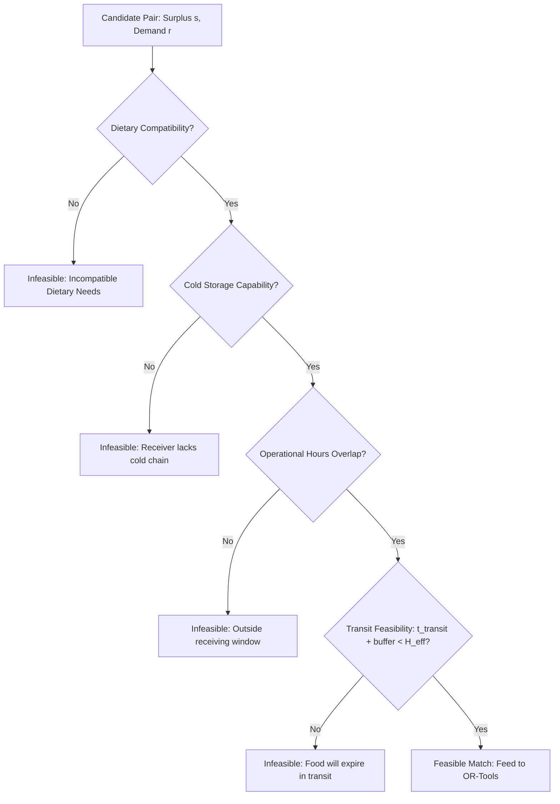

# FOOD HAS A DEADLINE (FHD) — MATCHING AND OPTIMISATION ARCHITECTURE

> **Core Engine:** Deterministic Perishability Engine & Google OR-Tools (Linear / Integer Programming)  
> **Status:** Mathematical & Algorithmic Specification  

---

## 1. Perishability Intelligence Architecture

Food Has a Deadline treats perishable food as a dynamic asset subject to physical, biological, and environmental decay. 

### 1.1 Strict Guardrail: Non-LLM Decay Modeling
> [!IMPORTANT]
> **No LLM Hallucination:** The Large Language Model is strictly prohibited from guessing or fabricating shelf-life metrics. All shelf-life decay estimations are calculated deterministically using empirical baselines and mathematical decay curves.
> 
> **No Safety Certification:** The platform is an operational prioritization heuristic, NOT a sanitary/safety certification agency. Users are reminded through explicit UI disclaimers that physical inspection at the point of handover is legally required.

### 1.2 Credible External Reference Sources
FHD calibrates its baseline degradation parameters from recognized international food authority datasets:
1. **USDA FoodKeeper App & Database:** Baseline shelf-life days per category and storage modality (Ambient, Refrigeration, Freezer).
2. **FDA Food Code & Bad Bug Book:** Maximum safe exposure thresholds for Temperature Control for Safety (TCS) foods.
3. **WRAP UK (Waste & Resources Action Programme):** Practical guidance on date labeling, redistribution of surplus, and post-harvest produce quality.
4. **FAO (Food and Agriculture Organization):** Post-harvest loss handling indices for tropical produce, dairy, and grains.

### 1.3 Perishability Computation Engine

#### Inputs:
1. $C$: Food Category ($\text{PRODUCE}, \text{DAIRY}, \text{BAKERY}, \text{PREPARED\_MEALS}, \text{MEAT}$)
2. $t_{\text{prep}}$: Harvest or Procurement Timestamp
3. $K_{\text{cond}}$: Visual / Physical Condition Factor ($\text{EXCELLENT}=1.0, \text{RIPE}=0.75, \text{IMMINENT}=0.4, \text{IMPERFECT}=0.85$)
4. $K_{\text{store}}$: Storage Factor ($\text{AMBIENT}=0.5, \text{REFRIGERATED}=1.0, \text{FROZEN}=3.0$)
5. $t_{\text{deadline}}$: Supplier-declared expiration timestamp
6. $t_{\text{now}}$: Current system timestamp

#### Mathematical Formulation:
The nominal remaining hours to deadline is:
$$\Delta t_{\text{nominal}} = \frac{t_{\text{deadline}} - t_{\text{now}}}{3600 \text{ seconds}}$$

The **Effective Usable Hours** ($H_{\text{eff}}$) incorporates storage condition and physical degradation:
$$H_{\text{eff}} = \max\left(0, \Delta t_{\text{nominal}} \cdot \left(\frac{K_{\text{cond}} \cdot K_{\text{store}}}{\bar{K}_{\text{baseline}}(C)}\right)\right)$$

#### Urgency Classification Tiers:
| Urgency Tier | Remaining Usable Time ($H_{\text{eff}}$) | Operational Meaning & Dispatch Protocol |
| :--- | :---: | :--- |
| **CRITICAL** | $H_{\text{eff}} < 6 \text{ hours}$ | Immediate dispatch required; priority routing; minimum stops. |
| **HIGH** | $6 \le H_{\text{eff}} < 24 \text{ hours}$ | Must be allocated in the next redistribution cycle; local radius. |
| **MODERATE** | $24 \le H_{\text{eff}} < 72 \text{ hours}$ | Normal scheduled allocation; multi-stop route batching allowed. |
| **LOW** | $H_{\text{eff}} \ge 72 \text{ hours}$ | Stable inventory; candidate for regional food bank redistribution. |

The **Normalized Urgency Score** ($U_{s,k} \in [0, 1]$) used in the optimization objective:
$$U_{s,k} = \min\left(1.0, \exp\left(-\frac{H_{\text{eff}}}{24}\right)\right)$$
As $H_{\text{eff}} \to 0$, $U_{s,k} \to 1.0$ (maximum urgency weight).

---

## 2. Multi-Factor Matching Pre-Filter

Before passing candidate pairs to Google OR-Tools, the **Matching Engine** evaluates binary compatibility to eliminate impossible connections and drastically reduce solver search space:



### 2.1 Geospatial Intelligence & Routing Engine

The geospatial intelligence subsystem computes physical distances, road travel durations, and temporal delivery viability across candidate pairs before passing them to the solver.

#### 1. Great-Circle Haversine Formula
For two points $(\phi_1, \lambda_1)$ and $(\phi_2, \lambda_2)$ on Earth (WGS84 ellipsoidal mean radius $R = 6371.0088 \text{ km}$):
$$\Delta \phi = \text{radians}(\phi_2 - \phi_1), \quad \Delta \lambda = \text{radians}(\lambda_2 - \lambda_1)$$
$$a = \sin^2\left(\frac{\Delta \phi}{2}\right) + \cos(\phi_1)\cos(\phi_2)\sin^2\left(\frac{\Delta \lambda}{2}\right)$$
$$c = 2 \cdot \text{atan2}\left(\sqrt{a}, \sqrt{1-a}\right)$$
$$d_{\text{haversine}} = R \cdot c \quad (\text{km})$$
* **Validation:** Coordinates are strictly bounded ($\phi \in [-90, +90], \lambda \in [-180, +180]$). Coincident origin-destination pairs return exactly $0.0 \text{ km}$.

#### 2. OSRM Road Network Integration
When available, driving routes are queried via OSRM (`/route/v1/driving/{origin_lon},{origin_lat};{dest_lon},{dest_lat}?overview=full&geometries=geojson`):
* Strict coordinate ordering: `{longitude},{latitude}` in URI path.
* Timeout limit: 3.0 seconds to prevent worker thread blocking.
* Returns actual road network distance, driving duration, and GeoJSON `LineString` coordinates.

#### 3. Deterministic Mathematical Fallback
If the external OSRM service is unreachable, times out, or returns a non-200 code:
* **Road Distance Approximation:** $d_{\text{road}} = d_{\text{haversine}} \times \kappa_{\text{circuity}}$, where $\kappa_{\text{circuity}} = 1.35$ represents empirical urban/suburban road circuity.
* **Travel Duration Approximation:** $t_{\text{travel}} = \frac{d_{\text{road}}}{v_{\text{commercial}}} \times 60 \text{ minutes}$, where $v_{\text{commercial}} = 35.0 \text{ km/h}$ accounts for urban delivery and stop-and-go conditions.
* **Zero Fake Geometry:** When fallback is triggered, `route_geometry` remains `null`. The system never fabricates turn-by-turn road geometry. The frontend renders a dashed straight-line visual indicator with an explicit fallback notice.

#### 4. Temporal Transit Feasibility Check
Redistribution is viable only if transit time plus handling and inspection buffer fits within the food's remaining usable lifetime:
$$t_{\text{available}} = \frac{t_{\text{deadline}} - t_{\text{now}}}{60} \quad (\text{minutes})$$
$$t_{\text{required}} = t_{\text{travel}} + \Delta_{\text{handling}} \quad (\text{default } \Delta_{\text{handling}} = 30 \text{ minutes})$$
$$\text{Feasibility Status} = \begin{cases}
\text{FEASIBLE} & \text{if } t_{\text{available}} \ge t_{\text{required}} \text{ (with warning if slack } < 60 \text{ min)} \\
\text{INFEASIBLE} & \text{if } t_{\text{available}} < t_{\text{required}} \text{ or } t_{\text{available}} \le 0 \\
\text{UNKNOWN} & \text{if coordinates or usable deadline are missing}
\end{cases}$$

### 2.2 Multi-Factor Supply-Demand Matching Engine (Module 7)

Before the system runs global multi-commodity linear programs in Google OR-Tools (Module 8), the **Matching Engine** evaluates pairwise compatibility between specific surplus batches and receiver demands.

#### 1. Separation of Concerns: Matching vs. Allocation Optimization
* **Matching (Module 7):** Candidate generation and feasibility filtering. Evaluates whether pair $(s, r)$ is physically, biologically, and temporally compatible. Strictly read-only, non-allocating, and transparently explained.
* **Allocation Optimization (Module 8):** Multi-commodity global solver (Google OR-Tools MILP). Decides the optimal mathematical split of quantities across the entire network graph simultaneously.

#### 2. Hard Constraints vs. Soft Preferences
* **Hard Constraints (Must be 100% satisfied for `ELIGIBLE` status):**
  1. *Listing Active Stock:* Surplus listing status is `ACTIVE` / `AVAILABLE` with $Q_s > 0$.
  2. *Demand Open Need:* Demand request status is `OPEN` / `ACTIVE` / `PARTIALLY_FULFILLED` with outstanding requirement $D_r > 0$.
  3. *Unexpired Food:* $t_{\text{now}} < t_{\text{deadline}}$ (expired food is strictly disqualified).
  4. *Product Compatibility:* Food category matches (or demand accepts `ANY`); core commodity noun aligns; dietary restrictions (Vegan, Vegetarian, Gluten-Free, Halal, Kosher) are respected; food condition satisfies receiver minimum threshold.
  5. *Cold Storage Hardware Compatibility:* Receiver possesses required refrigeration or freezer equipment matching surplus storage conditions.
  6. *Transit Feasibility:* Road transit time plus handling buffer fits within remaining shelf life ($t_{\text{required}} \le t_{\text{available}}$).
* **Soft Preferences (Influence score and ranking, NEVER override hard constraints):**
  1. *Receiver Priority:* Higher priority levels ($1 \le P_r \le 5$) boosted.
  2. *Proximity:* Shorter road distance prioritized.
  3. *Shelf-life Margin:* Greater slack ($t_{\text{available}} - t_{\text{required}}$) minimizes spoilage risk.
  4. *Quantity Overlap:* Higher overlap $\frac{\min(Q_s, D_r)}{\max(Q_s, D_r)}$ rewarded.

#### 3. Deterministic Candidate Scoring Formulation
Eligible candidates are ranked by a normalized composite score $S \in [0, 100]$:
$$S = 0.25 \cdot S_{\text{urgency}} + 0.25 \cdot S_{\text{proximity}} + 0.20 \cdot S_{\text{slack}} + 0.15 \cdot S_{\text{quantity}} + 0.15 \cdot S_{\text{priority}}$$

Where:
* $S_{\text{urgency}} = \text{clamp}\left(0, 100, \text{TierBase} + \Delta_{\text{hours}}\right)$ prioritizing urgent expiring food.
* $S_{\text{proximity}} = 100 \cdot \exp\left(-\frac{d_{\text{road}}}{25.0}\right)$ prioritizing local facilities.
* $S_{\text{slack}} = \text{function}(\text{slack\_minutes})$ penalizing tight delivery margins.
* $S_{\text{quantity}} = 40.0 + 60.0 \cdot \frac{\min(Q_s, D_r)}{\max(Q_s, D_r)}$ measuring volume alignment.
* $S_{\text{priority}} = \{5: 100, 4: 85, 3: 70, 2: 50, 1: 30\}$ honoring community need.

**Architectural Invariant:** If a candidate fails any hard constraint, $S = 0.0$ and `is_eligible = False`. Soft preferences can **never** convert an ineligible candidate into an eligible one.

---

## 3. Constrained Allocation Optimization with Google OR-Tools

The core allocation problem is modeled as a **Multi-Commodity Capacitated Transportation Network with Perishability and Priority Penalties**, solved using Google OR-Tools Linear Solver (`GLOP` for continuous LP or `CBC` / `SCIP` for integer/mixed-integer formulations).

### 3.1 Mathematical Formulation

#### Sets:
* $S = \{1, 2, \dots, m\}$: Set of active supplier surplus batches.
* $R = \{1, 2, \dots, n\}$: Set of active receiver demand requests.
* $K$: Food item categories.

#### Parameters:
* $Q_{s}$: Available quantity of surplus batch $s \in S$ (in kg).
* $D_{r}$: Requested quantity of demand $r \in R$ (in kg).
* $U_{s}$: Urgency score of surplus batch $s$ ($0 \le U_s \le 1$).
* $P_{r}$: Priority weight of receiver $r$ ($1 \le P_r \le 5$).
* $d_{s,r}$: Road or Haversine distance between supplier $s$ and receiver $r$ (in km).
* $t_{s,r}$: Estimated transit time (in hours).
* $C_{s,r} \in \{0, 1\}$: Binary compatibility indicator from pre-filter.
* $W_{\text{util}}$: Weight for total food quantity salvaged (default: $10.0$).
* $W_{\text{urgency}}$: Weight for prioritizing expiring food (default: $15.0$).
* $W_{\text{priority}}$: Weight for fulfilling high-need receivers (default: $5.0$).
* $W_{\text{dist}}$: Distance penalty weight per km (default: $0.2$).

#### Decision Variables:
* $x_{s,r} \ge 0$: Continuous variable representing the quantity (kg) of surplus $s$ allocated to receiver $r$.
* $u_{s} \ge 0$: Slack variable representing unallocated surplus of batch $s$.
* $v_{r} \ge 0$: Slack variable representing unfulfilled demand of receiver $r$.

---

### 3.2 Objective Function

Maximize total salvaged food, prioritizing critical urgency and vulnerable populations, while penalizing transportation mileage and route waste:

$$\max \sum_{s \in S}\sum_{r \in R} \left[ W_{\text{util}} \cdot x_{s,r} + W_{\text{urgency}} \cdot U_s \cdot x_{s,r} + W_{\text{priority}} \cdot P_r \cdot x_{s,r} - W_{\text{dist}} \cdot d_{s,r} \cdot x_{s,r} \right] - \sum_{s \in S} \Lambda_{\text{waste}} \cdot u_s$$

Where $\Lambda_{\text{waste}} = W_{\text{urgency}} \cdot U_s \cdot 2.0$ imposes a severe penalty on leaving urgent food unallocated.

---

### 3.3 Constraints

1. **Supply Capacity Constraint:**
   The total quantity allocated from any surplus batch cannot exceed its available quantity:
   $$\sum_{r \in R} x_{s,r} + u_s = Q_s \quad \forall s \in S$$

2. **Demand Intake Constraint:**
   The total quantity delivered to any receiver cannot exceed their requested intake capacity:
   $$\sum_{s \in S} x_{s,r} + v_r = D_r \quad \forall r \in R$$

3. **Compatibility & Route Viability:**
   Allocations can only occur if the pair passed the pre-filter:
   $$x_{s,r} \le M \cdot C_{s,r} \quad \forall s \in S, r \in R$$
   *(where $M = \min(Q_s, D_r)$)*

4. **Transit Horizon Feasibility:**
   If the estimated transit time plus safety buffer $\Delta_{\text{buffer}}$ exceeds the remaining usable time, the flow must be zero:
   $$x_{s,r} = 0 \quad \text{if } t_{s,r} + 0.5 > H_{\text{eff}}(s)$$

5. **Non-Negativity:**
   $$x_{s,r} \ge 0, \quad u_s \ge 0, \quad v_r \ge 0 \quad \forall s \in S, r \in R$$

---

## 4. Multi-Node Flexibility & Infeasibility Handling

### 4.1 Flexible Network Capabilities
* **One Supplier to Multiple Receivers (1-to-N):** A large 500 kg batch of bakery surplus can be partitioned across 3 local community centers (e.g., 200 kg, 150 kg, 150 kg).
* **Multiple Suppliers to One Receiver (N-to-1):** A regional pantry needing 1,000 kg can receive shipments from 4 local supermarkets.
* **Partial Allocation:** If a receiver demands 100 kg but a supplier only has 45 kg, OR-Tools will allocate the 45 kg partial match if distance permits.

### 4.2 Handling Infeasibility & Bottlenecks
In extreme scarcity or severe constraint scenarios (e.g. all receivers are too far, or dietary requirements mismatch), linear programs can become infeasible if modeled rigidly. FHD avoids crashes through:
1. **Slack Variables ($u_s, v_r$):** Guarantees a feasible mathematical solution always exists.
2. **Bottleneck Reporting:** The solver identifies exactly why surplus could not be allocated:
   * `REASON_DISTANCE_EXCEEDED`: Transit time exceeded remaining shelf-life.
   * `REASON_COLD_CHAIN_UNAVAILABLE`: Receiver lacked required refrigeration.
   * `REASON_CAPACITY_FULL`: All compatible local receivers have reached maximum daily intake.
3. **Automated Constraint Relaxation for Coordinators:** The AI Agent can suggest: *"Expanding dispatch radius from 15 km to 25 km unlocks 2 additional shelters with capacity for this 180 kg dairy batch."*

---

## 5. Module 8 Implementation: Google OR-Tools CP-SAT Optimizer

### 5.1 Architecture & Modular Package Structure
The optimization subsystem is encapsulated within `backend/app/optimization/`:

```
backend/app/optimization/
├── __init__.py               # Package exports
├── models.py                 # Pydantic schemas (RunRequest, ProposalResponse, Details, Diagnostics)
├── allocation_problem.py     # Graph representation, centigram scaling (100x), node/edge structs
├── constraint_builder.py     # CP-SAT decision variables & hard conservation constraints
├── objective_builder.py      # Multi-component integer objective function & coefficients
├── ortools_solver.py         # CpSolver runner with timeout, deterministic worker count, status mapping
├── proposal_explainer.py     # Deterministic audit diagnostics & unfulfilled demand explainer
└── allocation_service.py     # Orchestrator integrating DB, Module 7 matching, solving, & persistence
```

### 5.2 Integer Scaling & Precision Protection
Floating-point arithmetic in linear programs introduces numerical drift ($\pm 0.0000001\text{ kg}$) that conflicts with exact database storage (`NUMERIC(10, 2)`). FHD scales all kilogram quantities by a factor of 100 ($1\text{ kg} = 100\text{ centigrams}$):
$$\bar{Q}_s = \text{round}(Q_s \times 100), \quad \bar{D}_r = \text{round}(D_r \times 100)$$

The solver works entirely in the integer domain ($\mathbb{Z}^+$), guaranteeing exact supply conservation with zero fractional residue. Solved values are converted back to kilograms via $\frac{x}{100.0}$ with 2-decimal precision.

### 5.3 CP-SAT Optimization Formulation

#### 1. Decision Variables
For each eligible candidate pair $(s, r) \in E$ identified by Module 7:
$$x_{s,r} \in \left[0, \min(\bar{Q}_s, \bar{D}_r)\right] \quad \forall (s, r) \in E$$
For any pair $(s, r) \notin E$ (ineligible or review required), $x_{s,r} = 0$ implicitly (no variable created).

#### 2. Hard Constraints
* **Supply Conservation:** No surplus batch can be over-allocated:
  $$\sum_{r: (s, r) \in E} x_{s,r} \le \bar{Q}_s \quad \forall s \in S$$
* **Demand Conservation:** No receiver can be allocated more than requested:
  $$\sum_{s: (s, r) \in E} x_{s,r} \le \bar{D}_r \quad \forall r \in R$$
* **Non-Negativity:** $x_{s,r} \ge 0$.

#### 3. Weighted Integer Objective Function
$$\max \sum_{(s, r) \in E} C_{s,r} \cdot x_{s,r}$$

Where the unit coefficient $C_{s,r}$ incorporates:
$$C_{s,r} = W_{\text{base}} + W_{\text{urgency}}(s) + W_{\text{priority}}(r) + W_{\text{slack}}(s, r) - W_{\text{dist}}(s, r)$$

Parameters:
* $W_{\text{base}} = 1000$: Base reward ensuring moving food always yields positive net utility.
* $W_{\text{urgency}}(s) = \{\text{CRITICAL}: 500, \text{HIGH}: 300, \text{MODERATE}: 150, \text{LOW}: 50\}$.
* $W_{\text{priority}}(r) = P_r \times 50$ (Priority $1 \dots 5 \to 50 \dots 250$).
* $W_{\text{slack}}(s, r) = \min(100, \lfloor \text{slack\_minutes} / 10 \rfloor)$.
* $W_{\text{dist}}(s, r) = \min(500, \lfloor d_{\text{road}} \times 5 \rfloor)$.

### 5.4 Deterministic Unmet Demand Diagnostics
When a demand request cannot be completely fulfilled, the system classifies the exact operational cause:
| Reason Code | Operational Diagnostic Trigger |
| :--- | :--- |
| `NO_COMPATIBLE_SUPPLY` | Zero active listings in the requested food category. |
| `COLD_CHAIN_MISMATCH` | Candidate listings disqualified because receiver lacks required refrigeration. |
| `TRANSIT_INFEASIBLE` | Candidate listings disqualified because transit time exceeded remaining shelf-life. |
| `EXPIRED_SUPPLY` | Candidate listings had passed usable deadline before dispatch. |
| `INSUFFICIENT_SUPPLY` | Compatible supply volume was lower than requested demand intake. |
| `SUPPLY_ALLOCATED_TO_HIGHER_PRIORITY` | Supply was allocated to higher-urgency or higher-priority community facilities. |

### 5.5 Strict Safety Invariant: Read-Only Proposals
Generating an allocation proposal in Module 8 is strictly non-destructive:
1. `surplus_listings.remaining_quantity_kg` is **never decremented**.
2. `demand_requests.fulfilled_quantity_kg` is **never incremented**.
3. No `redistribution_transactions` rows are created.
4. Proposals are persisted with status `PENDING_REVIEW` awaiting explicit human coordinator review.

