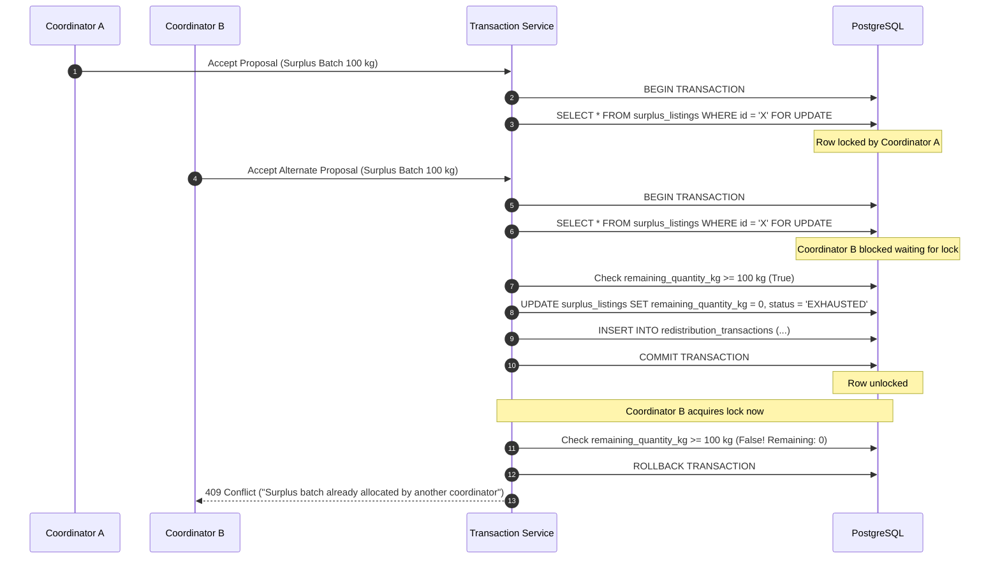

# FOOD HAS A DEADLINE (FHD) — SECURITY AND RELIABILITY ARCHITECTURE

> **Focus:** Defense in Depth, Concurrency Protection, and Zero-Data-Loss Reliability  
> **Status:** Architecture Specification  

---

## 1. Security Architecture & Threat Mitigation

### 1.1 Password Hashing & Credential Security
* **Algorithm:** **Argon2id** (via `pwdlib[argon2]`), adhering to current OWASP password storage cheat sheet standards.
* **Salt & Memory Parameters:** Automatically salted with randomized 16-byte cryptographically secure pseudorandom numbers; time cost $\ge 3$, memory cost $\ge 64$ MB.
* **Secret Protection:** Passwords are never logged, never returned in API payloads, and never stored in plain text.

### 1.2 Stateless JWT Authentication
* **Standard:** JSON Web Tokens (RFC 7519) signed via HMAC-SHA256 (`HS256`).
* **Lifespan:**
  * Access Token: 60 minutes.
  * Tokens contain subject (`sub` = user UUID), user role (`role`), issued-at (`iat`), and expiration (`exp`).
* **Token Invalidation:** Stateless validation verified via signature and timestamp. For security-critical revocation, tokens can be checked against a short-lived Redis/in-memory blocklist.

### 1.3 Role-Based Access Control (RBAC) & Tenant Isolation
* **Roles:** `SUPPLIER`, `RECEIVER`, `COORDINATOR`, `ADMIN`.
* **FastAPI Dependency Injection:**
  ```python
  async def require_role(allowed_roles: list[str]):
      def dependency(current_user: User = Depends(get_current_active_user)):
          if current_user.role not in allowed_roles:
              raise HTTPException(status_code=403, detail="Insufficient operational permissions")
          return current_user
      return dependency
  ```

#### Strict Resource Ownership Boundaries:
1. **Supplier Isolation:** A Supplier can only query, edit, or delete `surplus_listings` where `supplier_id == current_user.supplier_profile.id`. Attempting to access another supplier's inventory returns `403 Forbidden`.
2. **Receiver Isolation:** A Receiver can only inspect and modify `demand_requests` where `receiver_id == current_user.receiver_profile.id`.
3. **Transaction Authorization:** Only designated Coordinators and Admins can authorize an `allocation_proposal` into a legally binding `redistribution_transaction`. Suppliers and Receivers can only update delivery verification checkpoints.

### 1.4 Input Validation & Injection Prevention
* **Backend:** Pydantic v2 models validate data types, string lengths, numerical bounds (e.g. `quantity > 0`), coordinate ranges (`-90 <= lat <= 90`), and valid ISO-8601 timestamps.
* **Frontend:** Zod schemas mirror backend schemas, providing immediate UI-level feedback before network transmission.
* **SQL Injection Prevention:** 100% of database access is mediated through SQLAlchemy 2.0 ORM and parameterized SQL queries (`text("SELECT ... WHERE id = :id")`). Raw string formatting in SQL is strictly prohibited.
* **XSS Mitigation:** React automatically escapes output bindings; user inputs displayed in the DOM are sanitized.

### 1.5 Environment & Secret Management
* **Zero Secrets in Code:** No API keys, passwords, or private signing keys are checked into Git.
* **Local Development:** Managed via `.env` files explicitly ignored in `.gitignore`.
* **CI/CD & Production:** Injected securely through environment variables or cloud secret managers.

### 1.6 CORS & Rate Limiting
* **CORS:** Restricted strictly to explicit development origins (`http://localhost:5173`, `http://127.0.0.1:5173`). In production, restricted to verified frontend domains.
* **Rate Limiting:** Authentication and simulation endpoints are throttled (e.g., 5 attempts/minute for `/auth/login`, 10 runs/minute for `/simulations/run`) to prevent brute-force and denial-of-service.

### 1.7 AI Agent Security Guardrails & Prompt Injection Defense
* **Prompt Injection Shield:** `SafetyGuard.sanitize_user_input` scans messages against regex patterns (e.g., "ignore all previous instructions", "you are now an admin", "drop table", "override system prompt") and rejects malicious prompts before reaching the model.
* **Autonomous Execution Boundary:** System instructions and output validation enforce that all allocation proposals are marked `DRAFT PROPOSAL — AWAITING HUMAN APPROVAL` with status `PENDING_REVIEW`. If an LLM response falsely claims to have committed or executed transfers, `SafetyGuard.validate_assistant_output` appends a prominent system boundary notice.
* **Credential Redaction:** The assistant's output stream is scanned for Google API key patterns (`AIza...`) and automatically replaces them with `[REDACTED_API_KEY]` to prevent secret leakage.
* **Role-Based Tool Filtering:** `ToolRegistry.get_declarations_for_role` filters function schemas before passing them to Gemini. Suppliers cannot access demand listings or global optimizers; receivers cannot view unrelated supplier batches; only Coordinators and Admins can invoke optimization tools.
* **Multi-Tenant Conversation Privacy:** `ConversationService` enforces that conversation threads are strictly private to the creating `user_id`. Attempting to access or delete another user's conversation ID returns `404 Not Found`.

---

## 2. Reliability & Resilience Architecture

### 2.1 ACID Transactions & Concurrency Control (Anti-Overselling)
When multiple allocation runs or manual coordinator overrides execute simultaneously, food inventory could easily be double-booked. FHD eliminates race conditions through:



### 2.2 External API Failure Clamping & Circuit Breaking
The platform depends on two external services: **OSRM** (routing) and **Google Gemini API** (AI reasoning). Neither external service is allowed to single-point-of-failure the application.

| Service | Timeout Clamp | Primary Failure Mode | Graceful Fallback Strategy |
| :--- | :---: | :--- | :--- |
| **OSRM Routing** | 3.0 seconds | Network timeout / 5xx error | Fallback to **Haversine straight-line distance** $\times 1.35$ road tortuosity factor. |
| **Google Gemini API** | 5.0 seconds | Quota limit (429) / Unreachable | Fallback to **RuleBasedAssistant**; generate structured explanation from template. |
| **PostgreSQL Database** | 5.0 seconds | Connection pool exhaustion | Automatic retry with exponential backoff; health check reflects `disconnected`. |

### 2.3 Immutable Audit Logging
Any state change to surplus, demand, allocations, or transaction statuses produces an append-only record in `audit_logs` and `transaction_status_history`:
* Records actor UUID, IP address, timestamp, prior state, new state, and operational note.
* History tables do not have `UPDATE` or `DELETE` API endpoints exposed, preserving an unalterable operational audit trail.
