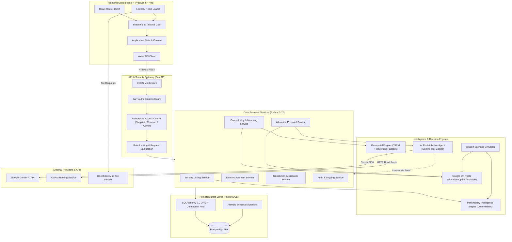
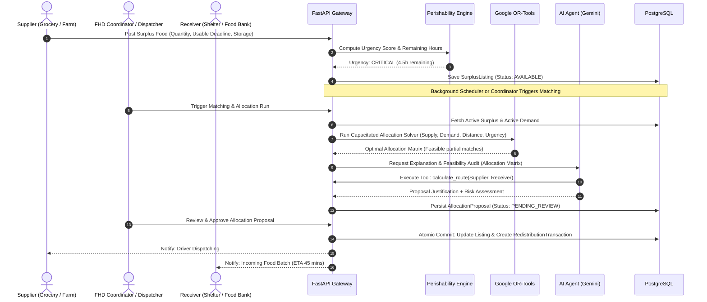

# FOOD HAS A DEADLINE (FHD) — SYSTEM ARCHITECTURE

> **Tagline:** *Move food before time runs out.*  
> **Module:** Architecture and Technical Design  
> **Status:** Modules 0–9 Implemented & Verified  

---

## 1. Executive System Overview

**Food Has a Deadline (FHD)** is an intelligent, perishability-aware food redistribution engine designed to solve the critical logistics bottleneck in perishable food rescue: **the deadline**. 

Traditional food donation systems treat food as static inventory. FHD treats food as a dynamic, decaying asset where every passing hour reduces allocation viability, increases transport risk, and shrinks candidate receiver compatibility. 

FHD combines:
1. **Deterministic Perishability Intelligence:** Mathematically computes decay rates, remaining shelf-life, and urgency scores without relying on LLM arithmetic.
2. **Constrained Operations Research Optimization (Google OR-Tools):** Solves multi-supplier, multi-receiver capacitated allocation problems subject to time horizons, volume constraints, dietary requirements, and cold-chain capabilities.
3. **Agentic AI Orchestration (Google Gemini API):** Synthesizes multi-factor operational data, invokes deterministic tools, simulates disruption scenarios, and explains complex distribution proposals to human coordinators.
4. **Geospatial Dispatch Engine (OSM / OSRM / Leaflet):** Evaluates transit time viability and routing feasibility across supplier-receiver networks.
5. **Human-in-the-Loop Governance:** AI and optimization engines produce *Proposals*; authorized human coordinators retain exclusive authority to commit transactions.

---

## 2. High-Level Architecture Diagram

---

## 3. Core Component Responsibilities

### 3.1 Frontend Client
* **Technology:** React 19, TypeScript, Vite, Tailwind CSS, shadcn/ui, React Router DOM, Axios, Leaflet, React Leaflet, Lucide React, React Hook Form, Zod.
* **Responsibilities:**
  * Renders responsive, accessible interfaces for Suppliers, Receivers, and Logistics Coordinators.
  * Real-time countdowns and visual perishability badges (Critical, High, Moderate, Low).
  * Interactive map views rendering active supply nodes, recipient facilities, and proposed transit corridors.
  * What-if simulation interactive sandbox allowing operators to test disruptions before approving allocations.
  * Client-side form validation using Zod schemas matching backend Pydantic models.

### 3.2 API & Security Layer
* **Technology:** FastAPI, Pydantic v2, PyJWT, `pwdlib[argon2]`.
* **Responsibilities:**
  * Exposes strictly typed, OpenAPI-documented RESTful endpoints.
  * Enforces JWT stateless authentication with short-lived access tokens and refresh mechanisms.
  * Validates incoming request payloads with Pydantic before hitting business logic.
  * Enforces Role-Based Access Control (RBAC) preventing cross-tenant data leaks.
  * Configures Cross-Origin Resource Sharing (CORS) restricted to authorized frontend origins.

### 3.3 Core Business Services
* **SurplusService:** Manages supplier inventory batches, harvest/production timestamps, initial condition, packaging type, and cold-chain requirements.
* **DemandService:** Manages receiver request quotas, population served, dietary restrictions (Halal, Kosher, Vegetarian, Vegan), and intake deadlines.
* **MatchingService:** Multi-factor deterministic candidate generation and feasibility evaluator. Evaluates product compatibility, dietary restrictions, condition thresholds, cold chain storage capabilities, and transit feasibility before global optimization. Strictly read-only.
* **AllocationService:** Orchestrates the Google OR-Tools CP-SAT Constrained Allocation Optimizer (`app/optimization/`). Ingests eligible candidate pairs, sets up supply/demand hard conservation constraints, maximizes weighted urgency/priority utility while penalizing transit mileage, extracts allocations to exact hundredths of a kilogram ($0.01\text{ kg}$, $100\times$), generates unmet demand diagnostics, and persists proposals as `PENDING_REVIEW` without inventory mutation.
* **ConversationService:** Manages multi-tenant conversation threads and message persistence (`conversations`, `conversation_messages`), enforcing tenant isolation, message chronological ordering, and bounded context windows to prevent token exhaustion.
* **ProposalService:** Coordinates the lifecycle of allocation proposals generated by OR-Tools and reviewed by the AI Agent.
* **TransactionService:** Executes atomic state transitions from `PROPOSED` $\to$ `ACCEPTED` $\to$ `DISPATCHED` $\to$ `RECEIVED` $\to$ `COMPLETED` with audit logging and concurrency locking.
* **AuditService:** Records append-only, tamper-evident logs of all operational transitions and user actions.

### 3.4 Intelligence Engines
* **Perishability Intelligence Engine:** Deterministic calculation of usable remaining life based on storage conditions (ambient, refrigerated, frozen) and product decay curves from USDA FoodKeeper and WRAP guidelines.
* **Google OR-Tools Allocation Optimizer:** Formulates and solves a Mixed-Integer Linear Program (MILP) maximizing perishability-weighted food salvage while minimizing distance and respecting receiver quotas.
* **Geospatial Intelligence Engine:** Computes great-circle (Haversine) distances, driving route distances, travel durations, and temporal shelf-life transit feasibility ($available\_minutes \ge transit\_duration + handling\_buffer$). Queries external OSRM (`/route/v1/driving/{lon},{lat}`) with a 3.0-second timeout; if external routing is unavailable or fails, gracefully falls back to deterministic approximation ($1.35\times$ circuity factor, $35 \text{ km/h}$ average commercial vehicle speed). Strictly enforces zero fabricated geometry: when fallback is active, route geometry is null, and the frontend renders dashed straight-line visual indicators. All coordinates originate from verified facility profiles in PostgreSQL.
* **AI Redistribution Agent:** Leverages Google Gemini 2.5 Flash via `google-genai` SDK with function calling across 10 deterministic tools. Never computes math or routing inside neural weights; inspects actual PostgreSQL state, evaluates perishability decay, identifies candidates, and runs OR-Tools optimization. Enforces prompt injection protection, redacts API keys, preserves human approval boundaries (`DRAFT PROPOSAL — AWAITING HUMAN APPROVAL`), and features a zero-downtime deterministic fallback engine when Gemini is unconfigured or quota-constrained (HTTP 429).
* **What-If Scenario Simulator:** Clones live state in memory to evaluate hypothetical shocks (e.g., recipient vehicle breakdown, sudden closure, heatwave shelf-life reduction) without mutating production database tables.

### 3.5 Persistent Data Layer
* **Technology:** PostgreSQL 16+, SQLAlchemy 2.0, psycopg 3 binary, Alembic.
* **Responsibilities:**
  * Relational storage enforcing foreign key constraints, uniqueness, positive quantities, and valid state transitions.
  * Row-level locking (`SELECT FOR UPDATE`) during allocation confirmation to prevent inventory overselling.
  * Indexing on geospatial coordinates, status flags, and expiry timestamps for low-latency queries.

---

## 4. End-to-End Operational Lifecycle

---

## 5. Architectural Invariants & Separation of Concerns

1. **No LLM Mathematics:** The Large Language Model (Gemini) is strictly forbidden from calculating distances, remaining shelf-life, or inventory allocations. All quantitative decisions are executed by deterministic Python algorithms or Google OR-Tools.
2. **API $\to$ Service $\to$ Repository $\to$ Database:**
   * **API Routers:** Only parse HTTP, enforce auth, validate schemas, and call Services.
   * **Services:** Contain business rules, coordinate engines, and execute transactions.
   * **Repositories:** Encapsulate SQLAlchemy queries and database persistence.
   * **Database:** Enforces relational integrity and concurrency invariants.
3. **Intelligence Engine Transport Independence:** Neither `PerishabilityEngine`, `AllocationOptimizer`, nor `GeospatialEngine` import FastAPI, Request, or HTTP objects. They accept pure Python dataclasses / Pydantic models, allowing full unit-testability without an active web server.
4. **Non-Destructive Simulation:** All what-if scenarios operate on cloned in-memory models. No simulation execution ever issues an `INSERT`, `UPDATE`, or `DELETE` to production transaction or inventory tables.
